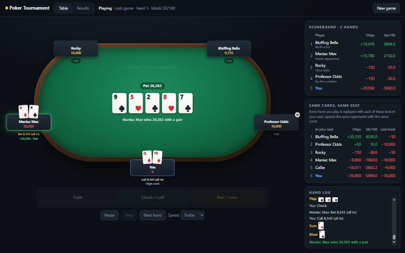
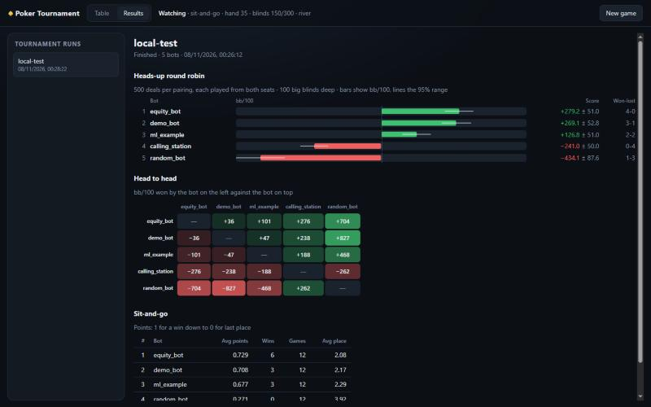

# Poker Tournament

Build a poker bot, train it however you like, and play it against everyone else's.

Everyone clones this repo and builds a bot. It can be hand-written rules, simulation, machine learning, reinforcement learning, or anything else that runs in Python. You submit it before the deadline. The organizer then runs every bot against every other bot on one machine and publishes the leaderboard here. There are several rounds. After each one you get the results and the hand histories, so you can study the field and come back stronger.

The game is **no-limit Texas hold'em**. The main event is **heads-up** (one against one) and **duplicate**: every deal is played twice with the seats swapped, so neither bot gets the better cards. Every bot plays every other bot, and the winner is the bot that wins the most chips on average.

```
 you                                         organizer
 ───                                         ─────────
 clone repo ─► poker new ─► build & train
                 ▲               │
                 └── poker match / poker run (test against the built-in bots)
                                 │
                     poker validate ─► submit ─────►  poker collect / zips
                                                          │
                                                       poker run  (every bot vs every bot)
                                                          │
 study results & hand histories  ◄──────────────────  results/<round>/leaderboard.md
```

## Taking part

**1. Install** (Python 3.11 or newer):

```bash
git clone https://github.com/Ewan1303/Poker-Tournament.git
cd Poker-Tournament
python -m venv .venv
```

Activate the environment with `.venv\Scripts\activate` on Windows or `source .venv/bin/activate` on Mac and Linux, then:

```bash
pip install -e .
pip install -r requirements-bots.txt
```

The first line installs the `poker` command. The second installs the machine-learning libraries bots are allowed to use (numpy, scipy, scikit-learn, pandas and PyTorch); skip it if you don't need them.

**2. Create your bot:**

```bash
poker new my_bots/alice
```

This copies the [starter bot](templates/starter_bot/bot.py) into `my_bots/alice/`. Git ignores `my_bots/`, so your code stays out of this repo. Keep it in your own private repo instead (see [SUBMITTING.md](SUBMITTING.md)).

**3. Make it good**, and test it against the built-in bots as you go:

```bash
poker match my_bots/alice equity_bot --hands 1000
poker run bots my_bots/alice
```

The first command plays a duplicate match. The second runs a small tournament against every bot in [bots/](bots).

## The built-in bots

Eight simple opponents with personalities, each one testing a different weakness. None of them is meant to win; a good bot should beat them all.

| | | |
|---|---|---|
| **Randy** (`random_bot`) does anything at random | **Callie** (`calling_station`) calls everything | **Maniac Max** (`maniac`) raises nearly every hand |
| **Rocky** (`rock`) plays only premium hands | **Bluffing Bella** (`bluffer`) bets whenever nobody else has | **Nervous Nick** (`fit_or_fold`) folds unless the flop hits him |
| **Professor Odds** (`equity_bot`) bets when the odds are right | **Lenny the Learner** (`ml_example`) the machine-learning example | |

`poker bots` describes each one and how to beat it, and so does [bots/README.md](bots/README.md).

**4. Check it** the way the organizer will:

```bash
poker validate my_bots/alice
```

**5. Submit** before the deadline: see [SUBMITTING.md](SUBMITTING.md).

## Watch and play in your browser

```bash
poker play
poker watch
poker results
```

- **`poker play`** opens a table in your browser where you play against the bots. Use the buttons, the raise slider, or the keys F (fold), C (check/call) and R (raise).
- **`poker watch`** seats the bots around one table with every card face up. You can pause, step one action at a time, or speed up to Instant to watch thousands of hands.
- **`poker results`** shows tournament leaderboards as charts.

Every bot in `bots/` and in your `my_bots/` folder is available, or you can name the ones you want: `poker play equity_bot my_bots/alice`. Choose **New game** in the page to switch between playing and watching, between a cash game and a sit-and-go, or to change who is at the table.



**How do you compare?** In a cash game, every hand you play is replayed in the background with each bot sitting in your seat, against its own copies of the same opponents with exactly the same cards. The *Same cards, same seat* panel adds those results up, so you can see whether you played your hands better than Professor Odds would have. It's the same idea as the tournament's duplicate format, applied to you. Hover over a seat to see that bot's description.



## Writing a bot

A bot is a folder with a `bot.py` that defines a class called `Bot`:

```python
from poker_tournament import Action, PokerBot, estimate_equity

class Bot(PokerBot):
    def act(self, obs):
        # obs.hole_cards, obs.board, obs.pot, obs.to_call, obs.min_raise_to, obs.players, obs.history ...
        equity = estimate_equity(obs.hole_cards, obs.board, opponents=len(obs.active_opponents))
        if obs.can_raise and equity > 0.7:
            return Action.raise_to(obs.raise_to_pot_fraction(0.75))
        if obs.to_call == 0:
            return Action.check()
        return Action.call() if equity > obs.pot_odds else Action.fold()
```

Put model files in the same folder and load them in `__init__`. Optional hooks, `on_match_start` and `on_hand_end`, tell you who you're playing and show what happened in each hand, including any cards shown at showdown. The full reference is in [docs/BOT_API.md](docs/BOT_API.md).

## Machine learning

The engine is plain Python with no dependencies, so you can generate as much data as you like:

- `poker match a b --hands 50000 --log data/hands.jsonl.gz` records every hand, with all hole cards.
- `poker_tournament.env.HeadsUpEnv` is a gym-style environment for reinforcement learning.
- `poker_tournament.features` turns cards and game state into feature vectors.
- [bots/ml_example](bots/ml_example) is the whole pipeline in one place: make data, train a model with numpy, save the weights, and load them in the bot.
- After each round, the hand histories of every match are published, so you can train on the field.

[docs/ML_GUIDE.md](docs/ML_GUIDE.md) covers the data format and some approaches worth trying.

## Rules in brief

- 100 big blinds each at the start of every hand (10,000 chips, blinds 50/100). Every pair of bots plays 1,000 deals from both seats.
- Ranking: big blinds won per 100 hands (bb/100), averaged over all opponents.
- 1 second per decision, 60 seconds to load, one CPU core, no GPU, 50 MB per bot.
- Standard library plus numpy, scipy, scikit-learn, pandas and PyTorch only.
- No reading or writing files outside your folder, no network, no collusion.

The full rules, the optional sit-and-go side event and the round schedule are in [RULES.md](RULES.md).

## Running the tournament

Organizers: see [ORGANIZER.md](ORGANIZER.md) for collecting submissions, running a round safely and publishing results.

## What's in here

| Path | What it is |
|---|---|
| [poker_tournament/](poker_tournament) | The engine, hand evaluator, bot sandbox, tournament runner and the `poker` command; `web/` and `arena.py` are the browser table |
| [bots/](bots) | Eight built-in test opponents with personalities, from Randy (random) to Professor Odds (rule-based) and Lenny (machine learning) |
| [templates/starter_bot/](templates/starter_bot) | What `poker new` copies |
| [docs/](docs) | Bot API reference and machine-learning guide |
| [results/](results) | Leaderboards from each round |
| [tests/](tests) | Tests for the rules, the evaluator, the sandbox and the tournament (`pytest`) |
